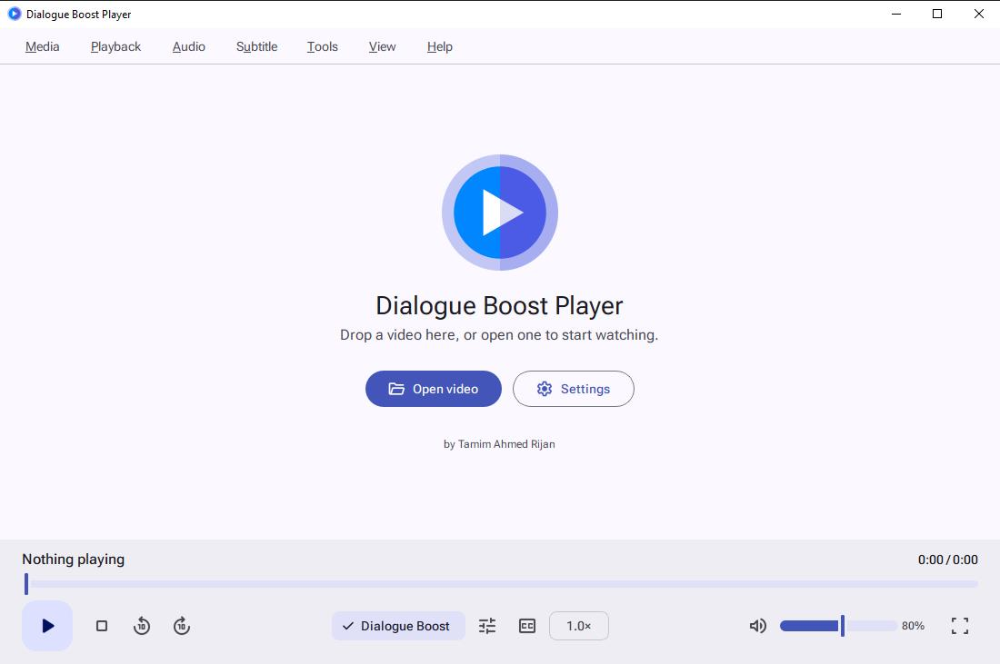
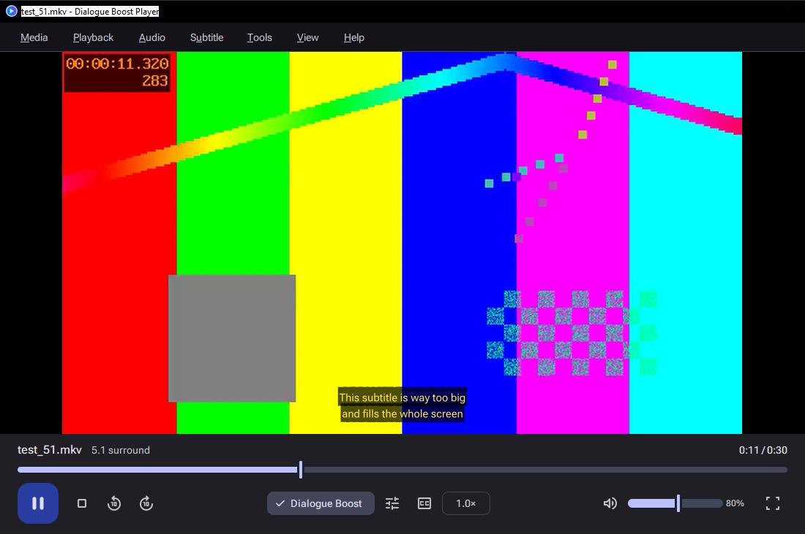
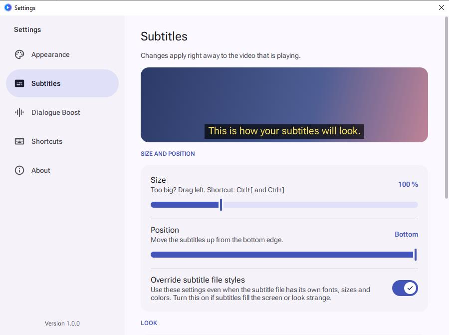
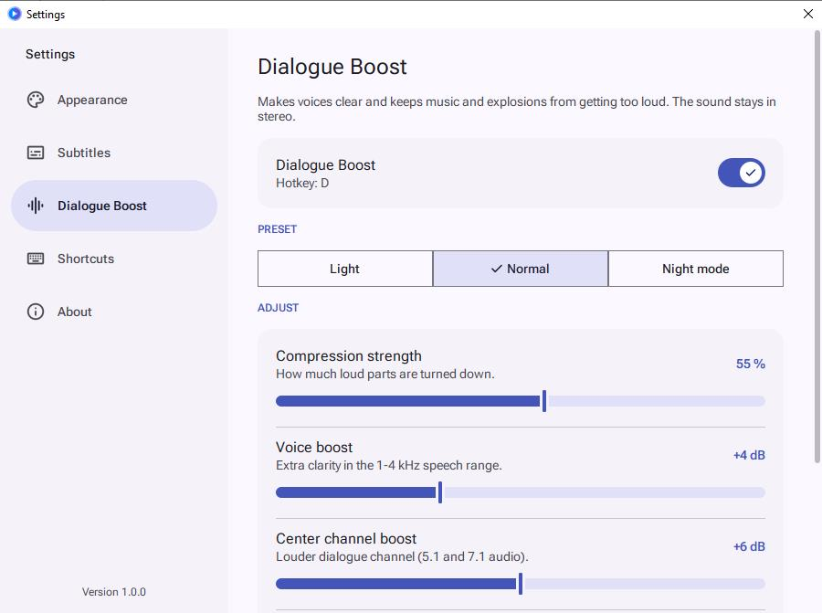
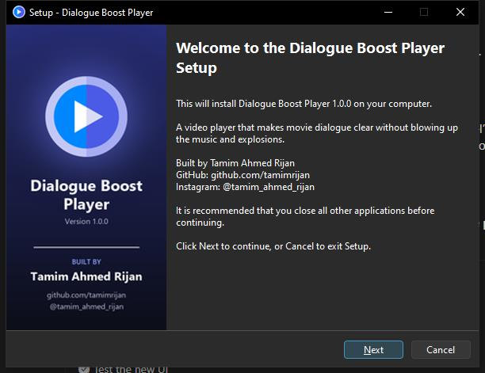

<div align="center">


# Dialogue Boost Player

### Hear every word. Without the explosions blowing your ears off.

A Windows video player that makes quiet movie dialogue clear and tames loud music and explosions,<br>
while keeping **real stereo** sound. No more riding the volume button all movie long.

<br>

[](https://github.com/tamimrijan/Dialogue-Boost-Player/releases/latest)

<br>


<br>




</div>

<br>

## 🎬 The problem

You start a movie at a normal volume. The characters whisper, so you turn it up. Then an explosion
nearly knocks you off the couch, so you turn it down. Repeat for two hours.

The usual trick, switching the player to **mono**, helps a bit but throws away stereo, and it does nothing
for the real cause: movies are mixed for cinemas, with a huge gap between quiet and loud.

**Dialogue Boost Player fixes the cause.** It pulls the dialogue forward and squeezes that gap,
and the sound stays **stereo**. It's perfect for laptop speakers, headphones and 2.1 speaker setups.

## ✨ Features

<table>
<tr>
<td width="50%" valign="top">

### 🔊 Dialogue Boost
- Boosts the **center channel** of 5.1 / 7.1 audio, where films put the dialogue
- Voice clarity EQ in the 1-4 kHz speech range
- Compressor + dynamic normalizer to even out loud and quiet scenes
- Limiter, so nothing ever clips
- Presets: **Light**, **Normal** and **Night mode**
- On by default, toggle with **D**, and every change applies **live**

</td>
<td width="50%" valign="top">

### 💬 Subtitle control
- **Resize** subtitles from 30% to 300% (fixes screen-filling ones)
- Move them up or down
- **Override** the styles of badly made `.ass` files
- Font, color, bold, outline or **dark box** background
- Delay adjust for out-of-sync subtitles
- Live preview while you tweak

</td>
</tr>
<tr>
<td width="50%" valign="top">

### 🎨 Material Design 3
- **Light** theme by default, plus **Dark** and **System**
- Roboto Flex font and official Material Symbols icons
- M3 components: FAB, chips, segmented buttons, switches and expressive sliders
- Fullscreen controls float over the video on **frosted glass** and hide themselves

</td>
<td width="50%" valign="top">

### 🧰 Everyday player stuff
- Plays mp4, mkv, avi, mov, webm and almost anything else
- Drag & drop, or **Open with** from Windows
- Audio and subtitle track selection, external `.srt` / `.ass` / `.vtt` files
- **Resumes** each video where you left off
- Playback speed, keyboard shortcuts
- A real **installer** with Start menu and desktop shortcuts and an uninstaller

</td>
</tr>
</table>

<div align="center">


</div>

## 📥 Download & install

1. Download **`DialogueBoostPlayer_Setup_1.1.0.exe`** from the [**latest release**](https://github.com/tamimrijan/Dialogue-Boost-Player/releases/latest).
2. Run it and follow the setup wizard. You can install for all users, or just for yourself (no admin needed).
3. Open it from the desktop shortcut, or right-click any video → **Open with** → **Dialogue Boost Player**.

> [!NOTE]
> Windows SmartScreen may show *"Windows protected your PC"*, because the installer isn't code-signed
> (signing certificates are expensive). Click **More info → Run anyway**.

Works on 64-bit **Windows 10 and 11**. Everything is included, so you don't need Python or anything else.

## ⌨️ Keyboard shortcuts

| Key | Action | | Key | Action |
|:---:|---|---|:---:|---|
| <kbd>Space</kbd> | Play / pause | | <kbd>M</kbd> | Mute |
| <kbd>←</kbd> <kbd>→</kbd> | Seek 5 seconds | | <kbd>D</kbd> | Dialogue Boost on / off |
| <kbd>↑</kbd> <kbd>↓</kbd> | Volume | | <kbd>Ctrl</kbd>+<kbd>[</kbd> <kbd>]</kbd> | Smaller / bigger subtitles |
| <kbd>F</kbd> / double-click | Fullscreen | | <kbd>Ctrl</kbd>+<kbd>O</kbd> | Open file |
| <kbd>Esc</kbd> | Leave fullscreen | | <kbd>Ctrl</kbd>+<kbd>P</kbd> | Settings |

## 🛠️ Run from source

<details>
<summary><b>Click to expand</b></summary>

<br>

1. Install **Python 3.10+ (64-bit)**.
2. Install the packages:

   ```bash
   pip install -r requirements.txt
   ```

3. Get **libmpv-2.dll**. It's the playback engine, and too big for this repository:
   - Download `mpv-dev-x86_64-YYYYMMDD-git-xxxxxxx.7z` from
     [shinchiro/mpv-winbuild-cmake releases](https://github.com/shinchiro/mpv-winbuild-cmake/releases)
   - Extract **`libmpv-2.dll`** with 7-Zip and put it next to `main.py`
4. Run:

   ```bash
   python main.py
   ```

</details>

## 📦 Build the installer

<details>
<summary><b>Click to expand</b></summary>

<br>

Install [Inno Setup 6](https://jrsoftware.org/isdl.php) and put `libmpv-2.dll` next to `main.py`, then:

```bash
pip install -r requirements-build.txt
```

```bash
python build.py
```

`build.py` does three steps:

1. **Artwork**: makes the app icon and the setup wizard images from `logo/play.png`
2. **App**: bundles Python, Qt, libmpv and the code with PyInstaller
3. **Setup**: compiles [`installer/setup.iss`](installer/setup.iss) into `release/DialogueBoostPlayer_Setup_<version>.exe`

To release a new version, change `VERSION` in [`app_info.py`](app_info.py) and build again.

<div align="center">

</div>

</details>

## 🗂️ Project structure

```
Dialogue-Boost-Player/
├── main.py              # starts the app, finds libmpv, handles "Open with"
├── app_info.py          # name, version, author, links
├── player.py            # thin wrapper around libmpv
├── audio_filters.py     # ⭐ the Dialogue Boost filter chain + presets
├── ui.py                # main window, menus, shortcuts, fullscreen glass bar
├── settings_window.py   # Settings: appearance, subtitles, Dialogue Boost, about
├── theme.py             # Material 3 light/dark colors, type scale, styles
├── icons.py             # Material Symbols icons that follow the theme
├── settings.py          # saves settings to %APPDATA%\DialogueBoostPlayer\config.json
├── build.py             # builds the app + installer
├── installer/setup.iss  # Inno Setup wizard script
├── fonts/               # Roboto Flex + Material Symbols
└── logo/play.png
```

## 🧱 Built with

[Python](https://www.python.org/) ·
[PySide6 / Qt 6](https://doc.qt.io/qtforpython-6/) ·
[mpv](https://mpv.io/) via [python-mpv](https://github.com/jaseg/python-mpv) ·
[FFmpeg](https://ffmpeg.org/) audio filters ·
[Roboto Flex](https://fonts.google.com/specimen/Roboto+Flex) ·
[Material Symbols](https://fonts.google.com/icons) ·
[PyInstaller](https://pyinstaller.org/) ·
[Inno Setup](https://jrsoftware.org/isinfo.php)

## 📄 License

The source code is released under the [MIT License](LICENSE).
The Windows installer bundles libmpv and FFmpeg, which are GPL-licensed; see [LICENSE](LICENSE) for all third-party parts.

<br>

<div align="center">

### 👨‍💻 Built by **Tamim Ahmed Rijan**

[](https://github.com/tamimrijan)
[](https://www.instagram.com/tamim_ahmed_rijan/)

If this player saved you from the volume button, consider giving it a ⭐

</div>
